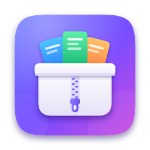

<p align="center"></p>

# Unrar for macOS

Ứng dụng giải nén native cho macOS (RAR, ZIP, 7z, TAR, GZ, BZ2, XZ…), viết bằng Swift/SwiftUI. Mục tiêu là trải nghiệm kiểu WinRAR nhưng với giao diện hiện đại của macOS.

## Cài đặt bằng Homebrew

```bash
brew tap quyvu01/unrar https://github.com/quyvu01/unrar
brew install --cask unrar-app
```

Cập nhật: `brew upgrade --cask --greedy unrar-app`. Gỡ: `brew uninstall --cask unrar-app`.
Bản `Unrar.zip` được GitHub Actions build và đăng lên mục Releases mỗi khi có commit mới trên `main`.

## Tính năng (bản 0.2)

- Mở tệp `.rar` (RAR 1.5 → RAR 7), kể cả tệp **nhiều phần** (`.part1.rar`, `.part2.rar`…). Mở phần bất kỳ thì app tự tìm phần đầu.
- Mở các định dạng phổ biến khác qua **libarchive**:

  | Định dạng | Ghi chú |
  | --- | --- |
  | ZIP (`.zip`, `.cbz`, `.jar`, `.epub`…) | Hỗ trợ mật khẩu ZipCrypto và AES-256 |
  | 7z (`.7z`, `.cb7`) | Kể cả tệp chia phần `.7z.001`, `.7z.002`… (mở phần nào cũng được). **Chưa** hỗ trợ 7z có mật khẩu |
  | TAR và TAR nén: `.tar`, `.tar.gz`/`.tgz`, `.tar.bz2`/`.tbz2`, `.tar.xz`/`.txz`, `.tar.zst`, `.tar.lz4`… | |
  | Tệp nén đơn: `.gz`, `.bz2`, `.xz`, `.lzma`, `.zst`, `.lz4`, `.Z` | Giải nén ra tệp gốc (`notes.txt.gz` → `notes.txt`) |
  | ISO, CAB, CPIO, XAR, LHA/LZH, AR/DEB | |
- **Duyệt nội dung** như Finder: sidebar cây thư mục, bảng tệp với icon hệ thống, kích thước, tỉ lệ nén, ngày sửa, sắp xếp theo cột, tìm kiếm toàn bộ tệp nén, nút Back/Forward/Lên thư mục cha.
- **Kéo thả**: thả tệp nén vào cửa sổ hoặc icon Dock để mở; kéo tệp/thư mục từ bảng ra Finder để giải nén riêng mục đó.
- **Giải nén** tất cả hoặc chỉ mục đã chọn, "Giải nén tới…" chọn thư mục, thanh tiến trình có tốc độ, thời gian còn lại và nút Hủy.
- **Mật khẩu**: RAR mã hóa dữ liệu và mã hóa cả tên tệp (`-hp`), ZIP (ZipCrypto / AES); báo sai mật khẩu và cho nhập lại.
- Kiểm tra tính toàn vẹn (Test), xem thông tin tệp nén (solid, recovery record, ghi chú/comment…).
- Nhấp đúp một tệp để mở nhanh bằng app mặc định.
- Cài đặt: nơi giải nén (cạnh tệp nén / thư mục cố định / luôn hỏi), tự tạo thư mục theo tên tệp nén (không tạo nếu bên trong chỉ có một thư mục/tệp), xử lý tệp trùng (giữ cả hai / ghi đè / bỏ qua), tự mở Finder sau khi giải nén.
- Giao diện tiếng Việt và tiếng Anh (theo ngôn ngữ hệ thống). Phím tắt: ⌘O mở, ⌘E giải nén, ⇧⌘E giải nén tới, ⌘T kiểm tra, ⌘↑ thư mục cha.
- An toàn: chặn đường dẫn độc hại (`../`, đường dẫn tuyệt đối) để tệp nén không ghi ra ngoài thư mục đích.

## Build và chạy

Yêu cầu: macOS 14 trở lên, Xcode 15.3+ (hoặc Swift 5.9+ toolchain).

```bash
# Chạy nhanh khi phát triển
swift run Unrar

# Đóng gói Unrar.app (universal Apple Silicon + Intel) vào ./build
scripts/build-app.sh
open build/Unrar.app
```

Có thể mở `Package.swift` trực tiếp bằng Xcode để debug. Mỗi lần push, GitHub Actions build `Unrar.app` trên macOS và đính kèm bản `.zip` trong mục Artifacts của workflow.

> App được ký ad-hoc. Lần đầu mở, nếu macOS chặn thì chuột phải vào app → **Open**.

Unrar tự đăng ký làm app mặc định cho `.rar` và `.7z`, và có trong menu **Open With** cho ZIP/TAR/GZ… Để đặt làm mặc định cho loại khác: chọn tệp trong Finder → **Get Info** → **Open with: Unrar** → **Change All…**

## Cấu trúc

| Thư mục | Nội dung |
| --- | --- |
| `Sources/CUnrar/unrar` | Mã nguồn UnRAR 7.0.7 gốc (không chỉnh sửa) |
| `Sources/CUnrar/shim.cpp` | API C nhỏ, dùng UTF-8, bọc `dll.hpp` của UnRAR |
| `Sources/CArchive` | Header libarchive 3.7.2 (BSD) để gọi `/usr/lib/libarchive.2.dylib` có sẵn trong macOS (Linux: `libarchive-dev`) |
| `Sources/ArchiveKit` | Thư viện Swift: `RARArchive` (UnRAR), `GenericArchive` (libarchive), `Archives.reader(for:)` chọn đúng bộ đọc |
| `Sources/UnrarApp` | App SwiftUI |
| `Sources/rarkit` | Công cụ dòng lệnh để thử nhanh: `swift run rarkit list|extract|test <tệp nén>` |
| `Tests/ArchiveKitTests` | Unit test với các tệp RAR, ZIP, 7z, TAR… mẫu (chạy được cả trên Linux) |
| `Casks/unrar-app.rb` | Homebrew cask (repo này đồng thời là tap) |

## Giấy phép

Các định dạng ngoài RAR được đọc bằng **libarchive** (giấy phép BSD 2-clause, xem `Sources/CArchive/LICENSE`). App dùng bản libarchive có sẵn trong macOS nên không phải đóng gói thêm thư viện. Icon vẽ bằng SVG (`docs/icon.svg`).

Phần giải nén RAR dùng mã nguồn **UnRAR** của Alexander Roshal, theo giấy phép UnRAR (xem `Sources/CUnrar/unrar/license.txt`). Giấy phép này cho phép dùng UnRAR miễn phí trong phần mềm để **đọc/giải nén** RAR, nhưng **không** được dùng để tạo trình nén tương thích RAR. Vì vậy app chỉ giải nén, không tạo tệp `.rar`.

> UnRAR source code may be used in any software to handle RAR archives without limitations free of charge, but cannot be used to develop RAR (WinRAR) compatible archiver and to re-create RAR compression algorithm, which is proprietary. Distribution of modified UnRAR source code in separate form or as a part of other software is permitted, provided that full text of this paragraph, starting from "UnRAR source code" words, is included in license, or in documentation if license is not available, and in source code comments of resulting package.
